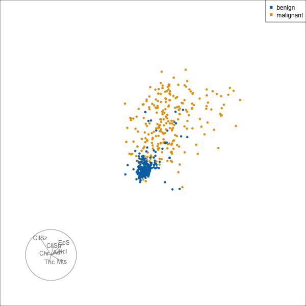
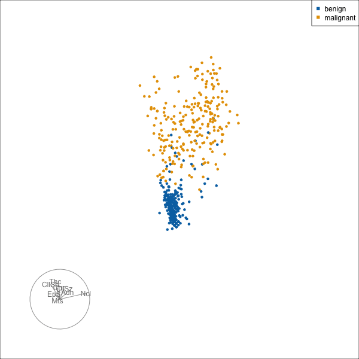
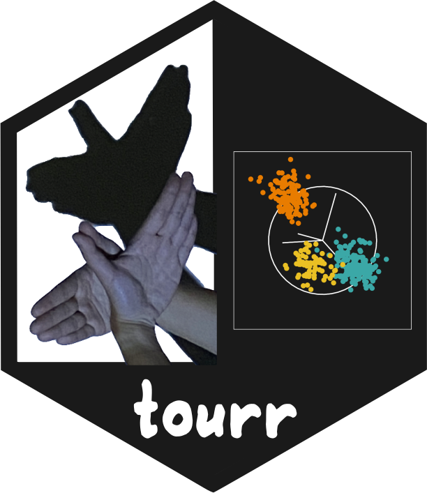
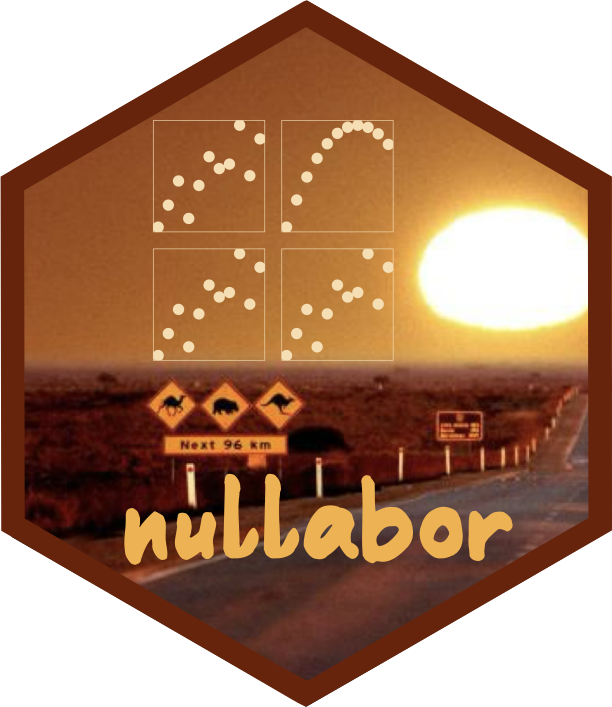

## Overview {.center}

1. `naniar` for visualising and summarising patterns of missingness
2. `tourr` for examining multivariable structure
3. `nullabor` for assessing visualisations using statistical inference, so that patterns seen in plots can be judged against null samples; and 
4. `brolgar` for exploring longitudinal data, including individual trajectories and patterns over time.

## Preamble

Doing research reproducibly

- literate programming, e.g. quarto documents, where code and text live together. Avoids cut and paste and mistakes made by forgetting to update if parameters or data change.
- version control, e.g. GitHub, to fully track changes to the work, able to back-track, branch

<br>

See the link at the bottom of these slides for resources to reproduce this talk.

```{r}
#| label: setup
#| include: false
library(tidyr)
library(readr)
library(ggplot2)
library(dplyr)
library(naniar)
library(tourr)
library(nullabor)
library(brolgar)
knitr::opts_chunk$set(fig.align = "center", message = FALSE, warning = FALSE)
# Colour-blind safe (Okabe-Ito) default for discrete colour and fill
okabe_ito <- c("#0072B2", "#E69F00", "#009E73", "#CC79A7", "#56B4E9", "#D55E00", "#F0E442")
options(ggplot2.discrete.colour = okabe_ito, ggplot2.discrete.fill = okabe_ito)
theme_set(theme_minimal(base_size = 14))
```

# `naniar` {.center}

Visualising and summarising missingness

## Why missing data matters

::::: {style="font-size: 80%;"}

- Missing values are the norm in clinical and epidemiological data
- Complete-case analysis can bias estimates and discard information

:::: {.columns}
::: {.column width="45%"}
**Theory starts from the mechanism**

- MCAR: unrelated to anything observed or unobserved
- MAR: related to observed variables
- MNAR: related to the unobserved value itself

These are assumptions about the process, and can't be checked from the data alone.
:::
::: {.column width="55%"}
**Data start from the sources**

- *Structural*: not applicable, or skipped by design (pregnancy for males, follow-up questions)
- *Coded*: `-99`, `"N/A"`, `0`, which aren't `NA` yet
- *Dropout*: subjects leave a study, often for reasons related to the outcome
- *Measurement*: below detection limit, failed assay, device off
- *Linkage*: records that didn't match when merging sources
:::
::::

Explore *where* values are missing, *what* is missing together, and how missingness relates to observed values.

:::::

## Summarising missingness

```{r}
#| label: naniar-summary
miss_var_summary(riskfactors) |> slice(1:8)
```

Also: `n_miss()`, `pct_miss()`, `miss_case_summary()`, `miss_var_span()`

## Visualising missingness

::: {.panel-tabset}

### Original order

```{r}
#| label: naniar-vis
#| fig-height: 4.2
#| fig-width: 10
#| out-width: "86%"
vis_miss(riskfactors) + theme(axis.text.x = element_text(angle = 90))
```

### Sorted

```{r}
#| label: naniar-vis-sorted
#| fig-height: 4.2
#| fig-width: 10
#| out-width: "80%"
vis_miss(riskfactors, sort_miss = TRUE, cluster = TRUE) +
  theme(axis.text.x = element_text(angle = 90))
```

::: {.f60}
Variables sorted by amount missing (`sort_miss = TRUE`); observations ordered by hierarchical clustering on missingness (`cluster = TRUE`).
:::

:::

## Missingness by variable and by case

:::: {.columns}
::: {.column width="50%"}
```{r}
#| label: naniar-miss-var
#| fig-height: 5.5
#| fig-width: 5.5
#| out-width: "78%"
gg_miss_var(riskfactors, show_pct = TRUE) +
  labs(title = "% missing in each variable")
```
:::
::: {.column width="50%"}
```{r}
#| label: naniar-miss-case
#| fig-height: 5.5
#| fig-width: 5.5
#| out-width: "78%"
gg_miss_case(riskfactors, show_pct = TRUE) +
  labs(title = "% of variables missing for each respondent")
```
:::
::::

## Missingness in relation to other variables

::: {.panel-tabset}

### Age vs BMI

:::: {.columns}
::: {.column width="55%"}
```{r}
#| label: naniar-shadow
#| fig-height: 5.5
#| fig-width: 5.5
ggplot(riskfactors, aes(x = age, y = bmi)) +
  geom_miss_point() +
  theme(aspect.ratio = 1)
```
:::
::: {.column width="45%"}
- Missing values are placed 10% below the minimum of that variable, so they appear in the margins
- Shadow matrices (`as_shadow()`, `bind_shadow()`) support checking whether missingness depends on observed variables
:::
::::

### Drinking

```{r}
#| label: naniar-miss-drink
#| fig-height: 5.5
#| fig-width: 5.5
ggplot(riskfactors, aes(x = drink_days, y = drink_average)) +
  geom_miss_point() +
  theme(aspect.ratio = 1)
```

### Poor health days

:::: {.columns}
::: {.column width="55%"}
```{r}
#| label: naniar-miss-health
#| fig-height: 5.5
#| fig-width: 5.5
ggplot(riskfactors, aes(x = health_physical, y = health_poor)) +
  geom_miss_point() +
  theme(aspect.ratio = 1)
```
:::
::: {.column width="45%"}
Missing `health_poor` occurs only when `health_physical` is 0: a structural skip, not random missingness.
:::
::::

### By sex

```{r}
#| label: naniar-miss-sex
#| fig-height: 5
#| fig-width: 10
ggplot(riskfactors, aes(x = weight_lbs, y = bmi)) +
  geom_miss_point() +
  facet_wrap(~ sex) +
  theme(aspect.ratio = 1)
```

:::

## Combinations of missingness

```{r}
#| label: naniar-upset
#| fig-height: 5.5
#| fig-width: 11
gg_miss_upset(riskfactors, nsets = 6, nintersects = 12)
```

Which variables are missing *together*: bars count respondents with each combination of missing variables.

# `tourr` {.center}

Examining multivariable structure

```{r}
#| label: tourr-make-gifs
#| eval: false
#| include: false
# Run manually to regenerate the tour GIFs in images/
library(tourr)

# V6 (bare nuclei) is the only variable with missing values, so drop it
b <- MASS::biopsy
X <- as.data.frame(scale(b[, c(2:6, 8:10)]))
colnames(X) <- c("Thickness", "CellSize", "CellShape", "Adhesion", "EpiSize", "Chromatin", "Nucleoli", "Mitoses")
cls <- b$class
pal <- c("#0072B2", "#E69F00")
disp <- function() display_xy(col = cls, palette = pal, cex = 1, axes = "bottomleft")

# Both tours start from the same random projection
set.seed(2931)
start <- basis_random(ncol(X), 2)
render_gif(X, grand_tour(), disp(), start = start, gif_file = "images/biopsy-grand.gif",
           apf = 1/15, frames = 150, width = 600, height = 600)

# Save the guided path, then replay it, so the radial tour starts where it ends
h <- save_history(X, guided_tour(lda_pp(cls)), start = start, max_bases = 10)
render_gif(X, planned_tour(h), disp(), gif_file = "images/biopsy-guided.gif",
           apf = 1/15, frames = 150, width = 600, height = 600)

basis <- matrix(h[, , dim(h)[3]], ncol = 2)
render_gif(X, radial_tour(basis, mvar = 1), disp(), gif_file = "images/biopsy-radial.gif",
           apf = 1/15, frames = 90, width = 600, height = 600)
render_gif(X, radial_tour(basis, mvar = 2), disp(),
           gif_file = "images/biopsy-radial-cellsize.gif",
           apf = 1/15, frames = 90, width = 600, height = 600)
render_gif(X, radial_tour(basis, mvar = 7), disp(),
           gif_file = "images/biopsy-radial-nucleoli.gif",
           apf = 1/15, frames = 90, width = 600, height = 600)
render_gif(X, radial_tour(basis, mvar = c(1, 3)), disp(),
           gif_file = "images/biopsy-radial-thick-shape.gif",
           apf = 1/15, frames = 90, width = 600, height = 600)
```

## Why tours?

- Biomedical data are rarely one- or two-dimensional: many measurements per subject
- Scatterplot matrices only show pairwise views
- A **tour** is a sequence of linear projections, from $p$-D to 1D or 2D, shown as an animation
- Reveals clusters, outliers, nonlinear dependence and linear structure that marginal plots miss
- Also for examining **model fits**: show the model in the data space
  - classification boundaries (LDA, trees, forests, neural nets), cluster solutions, fitted surfaces
  - check whether a model captures the structure, or where it misses it
- And for checking **model assumptions** before trusting a fit
  - LDA: groups are elliptical clouds with the same shape and orientation (equal variance-covariance)
  - clustering: $k$-means expects spherical, similar-sized clusters; model-based clustering expects elliptical ones; hierchical linkage is affects by nuisance variables and observations
  - statistical models are affected by multicollinearity

## Projections as data views

For data $X$ ($n \times p$) and an orthonormal projection matrix $A$ ($p \times d$):

$$
Y = XA
$$

- A tour interpolates smoothly between successive projection planes $A_1, A_2, \dots$
- Grand tour: random targets; guided tour: optimises an index (e.g. `holes()`, `cmass()`, `lda_pp()`) to find interesting views

## A tour in code

Eight cytology scores on 699 breast biopsies, benign or malignant (`MASS::biopsy`, standardised). V6 (bare nuclei), the only variable with missing values, is dropped.

```{r}
#| label: tourr-code
#| eval: false
X <- scale(MASS::biopsy[, c(2:6, 8:10)])
cls <- MASS::biopsy$class

set.seed(2931)
start <- basis_random(ncol(X), 2)

animate_xy(X, tour_path = grand_tour(), start = start, col = cls)

animate_xy(X, tour_path = guided_tour(lda_pp(cls)), start = start, col = cls)
```

- `animate_*()` displays in a graphics window; `render_gif()` saves for slides
- Other displays: `animate_dist()`, `animate_slice()`, `animate_pcp()`

## Grand tour and guided tour

:::: {.columns}
::: {.column width="50%"}
**Grand tour**: random target planes

{fig-alt="Grand tour of the biopsy data" width="600"}
:::
::: {.column width="50%"}
**Guided tour**: optimises the LDA index

{fig-alt="Guided tour of the biopsy data" width="600"}
:::
::::

Blue: benign, orange: malignant.

## Radial tour: is the structure sensitive to a variable?

:::: {.columns}
::: {.column width="50%"}
Start from the best guided-tour projection, then rotate selected variables fully out of, and back into, the view.

```{r}
#| label: tourr-radial
#| eval: false
h <- save_history(X, guided_tour(lda_pp(cls)), start = start,
                  max_bases = 10)
basis <- matrix(h[, , dim(h)[3]], ncol = 2)

animate_xy(X, radial_tour(basis, mvar = 1), col = cls)
animate_xy(X, radial_tour(basis, mvar = 2), col = cls)
animate_xy(X, radial_tour(basis, mvar = 7), col = cls)
animate_xy(X, radial_tour(basis, mvar = c(1, 3)), col = cls)
```

- Separation disappears when a variable is removed: the structure depends on it
- Separation persists: the variable is not needed for it
:::
::: {.column width="50%"}
::: {.panel-tabset}

### Thickness

{fig-alt="Radial tour rotating out Thickness" width="550"}

### CellSize

{fig-alt="Radial tour rotating out CellSize" width="550"}

### Nucleoli

{fig-alt="Radial tour rotating out Nucleoli" width="550"}

### Thickness + CellShape

{fig-alt="Radial tour rotating out Thickness and CellShape together" width="550"}

:::
:::
::::

## Linked brushing: scatterplot and tour

```{r}
#| label: tourr-linked
#| code-fold: true
#| code-summary: "Code"
library(detourr)
library(crosstalk)
library(plotly)

set.seed(6302)
biopsy_sd <- MASS::biopsy |>
  as_tibble() |>
  select(-V6) |>
  rename(Thickness = V1, CellSize = V2, CellShape = V3, Adhesion = V4,
         EpiSize = V5, Chromatin = V7, Nucleoli = V8, Mitoses = V9) |>
  mutate(
    # crosstalk keys must be character: plotly sends strings, and detourr
    # matches them against its own keys with indexOf()
    row = as.character(row_number()),
    across(Thickness:Mitoses, ~ as.numeric(scale(.x))),
    # Jitter only for the scatterplot: the scores are integers 1-10
    CellSize_j = jitter(CellSize, amount = 0.08),
    Nucleoli_j = jitter(Nucleoli, amount = 0.08)
  )
shared <- SharedData$new(biopsy_sd, key = ~ row)

scatter <- ggplot(shared, aes(x = CellSize_j, y = Nucleoli_j, colour = class,
                              text = paste("ID:", ID))) +
  geom_point(alpha = 0.6) +
  labs(x = "CellSize", y = "Nucleoli") +
  theme(aspect.ratio = 1, legend.position = "bottom")

scatter_ly <- ggplotly(scatter, width = 600, height = 600, tooltip = "text") |>
  highlight(on = "plotly_selected", off = "plotly_deselect", opacityDim = 0.15) |>
  layout(margin = list(l = 80, b = 60))

tour <- detour(shared, tour_aes(projection = Thickness:Mitoses, colour = class, label = ID)) |>
  tour_path(grand_tour(2), aps = 0.7, fps = 30, max_bases = 20) |>
  # Default scale_factor is 1 / (largest distance from the centre); enlarge a little
  show_scatter(palette = c("#0072B2", "#E69F00"), alpha = 0.7, size = 1.5,
               scale_factor = 1.3 / max(sqrt(rowSums(
                 scale(as.matrix(select(biopsy_sd, Thickness:Mitoses)), scale = FALSE)^2))),
               width = "600px", height = "600px")

# A flex container avoids the negative Bootstrap margins of bscols(), which crop the left edge
htmltools::div(
  style = "display: flex; justify-content: center; gap: 40px;",
  scatter_ly, tour
)
```

Select points in the scatterplot (box or lasso) to highlight them in the tour, or select in the tour to highlight them in the scatterplot. Hover over a point to see the sample ID.

## Reading a tour

- Look for separation between groups, outliers, and shape (linear vs curved)
- Axes in the display show variable contributions to the current view
- Caveat: with few observations and many variables, apparent structure may arise by chance. This motivates the next topic.

# `nullabor` {.center}

Assessing visualisations with statistical inference

## Is the pattern real?

- Plots are statistics: they can be viewed as test statistics
- Humans readily see patterns in noise
- The **lineup protocol** (Buja et al. 2009):
  1. State the null hypothesis, and how to simulate data under it
  2. Generate $m - 1$ null plots, and hide the real plot at a random position
  3. If an observer can pick out the data plot, this is evidence against the null
- If $x$ of $K$ independent observers pick the data plot, the p-value is $P(X \ge x)$, where $X \sim \text{Binom}(K, 1/m)$

## Longitudinal lineup: the null

Primary biliary cirrhosis trial (`survival::pbcseq`): 312 patients, repeated serum bilirubin over up to 14 years. Individual trajectories differ in level and shape.

**Question**: do log bilirubin trajectories differ between patients with advanced disease at baseline (histologic stage 4) and the rest?

- $H_0$: trajectories do not depend on baseline stage
- Under $H_0$, the stage label is exchangeable between **patients**
- So permute the label across patients, keeping each patient's trajectory intact. Never permute time or individual visits.

```{r}
#| label: nullabor-pbc-data
pbc_l <- survival::pbcseq |>
  as_tibble() |>
  mutate(years = day / 365.25)
baseline <- pbc_l |>
  filter(day == 0) |>
  transmute(id, advanced = factor(stage == 4, labels = c("Stage 1-3", "Stage 4")))
pbc_l <- left_join(pbc_l, baseline, by = "id")

null_permute_subject <- function(var, id = "id") {
  function(df) {
    labs <- distinct(df, .data[[id]], .data[[var]])
    labs[[var]] <- sample(labs[[var]])
    df |> select(-all_of(var)) |> left_join(labs, by = id)
  }
}
```

## Longitudinal lineup

```{r}
#| label: nullabor-lineup
#| fig-height: 7
#| fig-width: 12
set.seed(8164)
d <- lineup(null_permute_subject("advanced"), pbc_l, n = 20)
ggplot(d, aes(x = years, y = log(bili), colour = advanced)) +
  geom_line(aes(group = id), alpha = 0.15) +
  geom_smooth(se = FALSE, method = "loess", linewidth = 1.2) +
  facet_wrap(~ .sample, nrow = 4) +
  theme(axis.text = element_blank(), axis.title = element_blank(),
        legend.position = "none")
```

Which panel is different?

## The answer

```{r}
#| label: nullabor-answer
#| fig-height: 7
#| fig-width: 12
pos <- attr(d, "pos")
ggplot(d, aes(x = years, y = log(bili), colour = advanced)) +
  geom_line(aes(group = id), alpha = 0.15) +
  geom_smooth(se = FALSE, method = "loess", linewidth = 1.2) +
  geom_rect(data = tibble(.sample = pos), inherit.aes = FALSE,
            xmin = -Inf, xmax = Inf, ymin = -Inf, ymax = Inf,
            fill = NA, colour = "black", linewidth = 2) +
  facet_wrap(~ .sample, nrow = 4) +
  theme(axis.text = element_blank(), axis.title = element_blank())
```

The data are in panel `r pos`. If $x$ of $K$ observers pick it, $p = P(X \ge x)$ with $X \sim \text{Binom}(K, 1/20)$. Caveat: patients with advanced disease tend to leave the study earlier, so the late part of the curves is based on fewer, selected patients.

## How significant? Three ways to compute the p-value

Example: the same 20-panel lineup is shown to $K = 20$ observers, and $x = 4$ pick the data plot.

:::: {.columns}
::: {.column width="45%"}
```{r}
#| label: nullabor-pvalues
#| code-fold: true
#| code-summary: "Code"
x <- 4; K <- 20; m <- 20
set.seed(7315)
p_pvisual <- pvisual(x, K, m = m, N = 10000)[, "simulated"]
alphas <- c(0.1, 1, 5)
# upper tail via 1 - P(X <= x - 1): pVis(lower.tail = FALSE) is wrong in vinference 1.0.0
p_vinf <- sapply(alphas, \(a) 1 - vinference::pVis(x - 1, K = K, m = m, alpha = a))
tibble(
  Method = c("Binomial", "nullabor::pvisual()",
             paste0("vinference, alpha = ", alphas)),
  `P(X >= 4)` = c(1 - pbinom(x - 1, K, 1 / m), p_pvisual, p_vinf)
) |>
  knitr::kable(digits = 3)
```
:::
::: {.column width="55%" style="font-size: 85%;"}
- **Binomial** assumes independent picks; anti-conservative when everyone sees the same lineup
- **`pvisual()`** simulates shared panel "attractiveness" across observers (fixed amount of dependence)
- **`vinference`** models panel selection with a Dirichlet($\alpha$); estimate $\alpha$ from null-panel picks (`estimate_alpha_numeric()`). Small $\alpha$: observers agree on which nulls look odd
:::
::::

## Choices in a lineup

- Null generation must respect the data structure: permute labels at the level they were assigned (here, patients), not rows\n- Built-in options: `null_permute()` (independence), `null_dist()` (parametric), `null_lm()` (residual rotation); any function returning a null data set works
- Plot design matters: choose a type that makes the feature of interest visible
- Use several observers, and don't let anyone who has seen the real data judge
- Residual diagnostics are a natural application, where reference distributions are otherwise hard to judge

# `brolgar` {.center}

Exploring longitudinal data

## Longitudinal data

- Repeated measurements on the same subjects over time (growth, biomarkers, trials)
- Observations within a subject are correlated, and times may be irregular
- Aggregate summaries and spaghetti plots can hide individual behaviour
- `brolgar` builds on `tsibble`: key = subject, index = time

## Looking at individual trajectories

Reaction times of 18 sleep-restricted subjects over 10 days (`lme4::sleepstudy`).

```{r}
#| label: brolgar-spaghetti
#| fig-height: 5
#| fig-width: 10
sleep <- as_tsibble(lme4::sleepstudy, key = Subject, index = Days)
ggplot(sleep, aes(x = Days, y = Reaction, group = Subject)) +
  geom_line()
```

Overall upward drift, but subjects differ in baseline and slope.

## Sampling and faceting

```{r}
#| label: brolgar-facet
#| fig-height: 5
#| fig-width: 10
ggplot(sleep, aes(x = Days, y = Reaction, group = Subject)) +
  geom_line() +
  facet_sample(n_per_facet = 3, n_facets = 6) +
  theme(axis.text = element_blank())
```

`facet_strata()` splits subjects by a feature, such as the number of observations.

## Summarising features per subject

```{r}
#| label: brolgar-features
features(sleep, Reaction, feat_five_num) |> slice(1:6)
```

- Other helpers: `feat_ranges()`, `feat_monotonic()`, `feat_diff_summary()`
- `keys_near()` finds subjects close to a summary (e.g. the median), to show representative trajectories
- `add_n_obs()` and `n_obs()` check how unbalanced the data are

## Take-aways

- `naniar`: treat missingness as something to explore
- `tourr`: look at high-dimensional structure directly
- `nullabor`: calibrate what you see against null expectation
- `brolgar`: look at individuals, not just averages

::: {style="text-align: center; margin-top: 1em;"}
{height="180px" fig-alt="naniar hex sticker"}
{height="180px" fig-alt="tourr hex sticker"}
{height="180px" fig-alt="nullabor hex sticker"}
{height="180px" fig-alt="brolgar hex sticker"}
:::

## Resources {.smaller}

::: {style="font-size: 85%;"}

| Topic | Software | Paper |
|---|---|---|
| Missing data | [naniar](https://naniar.njtierney.com/) | Tierney & Cook (2023) [Expanding tidy data principles to facilitate missing data exploration, visualization and assessment of imputations](https://doi.org/10.18637/jss.v105.i07). *Journal of Statistical Software* 105(7) |
| Tours | [tourr](https://ggobi.github.io/tourr/) | Wickham, Cook, Hofmann & Buja (2011) [tourr: An R package for exploring multivariate data with projections](https://doi.org/10.18637/jss.v040.i02). *Journal of Statistical Software* 40(2); Cook & Laa (2026) [Interactively exploring high-dimensional data and models in R](https://dicook.github.io/mulgar_book/) (book, also free online) |
| Radial tour | [tourr `radial_tour()`](https://ggobi.github.io/tourr/reference/radial_tour.html) | Laa, Aumann, Cook & Valencia (2023) [New and simplified manual controls for projection and slice tours, with application to exploring classification boundaries in high dimensions](https://doi.org/10.1080/10618600.2023.2206459). *Journal of Computational and Graphical Statistics* 32(3) |
| Interactive tours | [detourr](https://casperhart.github.io/detourr/) | Hart & Wang (2023) [Taking the scenic route: Interactive and performant tour animations](https://doi.org/10.32614/RJ-2023-052). *The R Journal* |
| Linked plots | [plotly](https://plotly-r.com/), [crosstalk](https://rstudio.github.io/crosstalk/) | Sievert (2020) [Interactive web-based data visualization with R, plotly, and shiny](https://plotly-r.com/). Chapman & Hall/CRC |
| Visual inference | [nullabor](https://dicook.github.io/nullabor/), [vinference](https://github.com/heike/vinference) | Buja et al. (2009) [Statistical inference for exploratory data analysis and model diagnostics](https://doi.org/10.1098/rsta.2009.0120). *Phil. Trans. R. Soc. A* 367; Wickham et al. (2010) [Graphical inference for infovis](https://doi.org/10.1109/TVCG.2010.161). *IEEE TVCG* 16(6); VanderPlas, Röttger, Cook & Hofmann (2021) [Statistical significance calculations for scenarios in visual inference](https://doi.org/10.1002/sta4.337). *Stat* 10(1) |
| Longitudinal data | [brolgar](https://brolgar.njtierney.com/) | Tierney, Cook & Prvan (2022) [brolgar: An R package to BRowse Over Longitudinal Data Graphically and Analytically in R](https://doi.org/10.32614/RJ-2022-023). *The R Journal* 14(2) |

Slides and code: [https://github.com/dicook/VicBioStat-2026/](https://github.com/dicook/VicBioStat-2026/)

:::

## License {.center}

[{fig-alt="Creative Commons BY-NC-SA 4.0 license badge"}](https://creativecommons.org/licenses/by-nc-sa/4.0/)

This work is licensed under a [Creative Commons Attribution-NonCommercial-ShareAlike 4.0 International License](https://creativecommons.org/licenses/by-nc-sa/4.0/).
